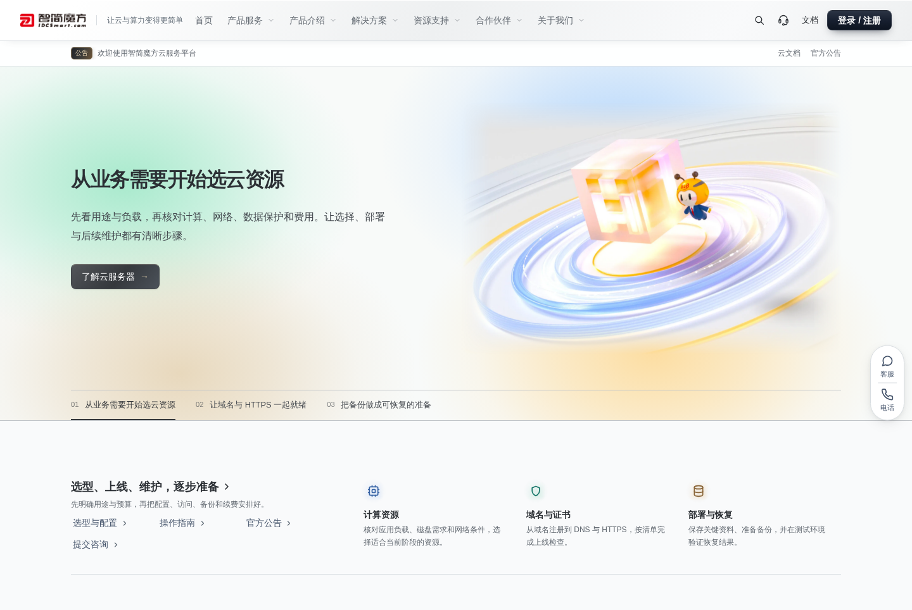
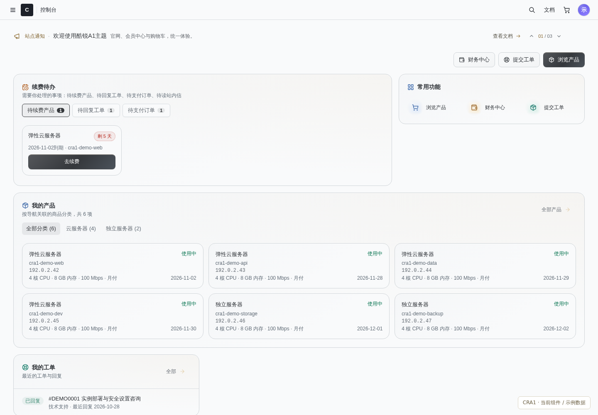
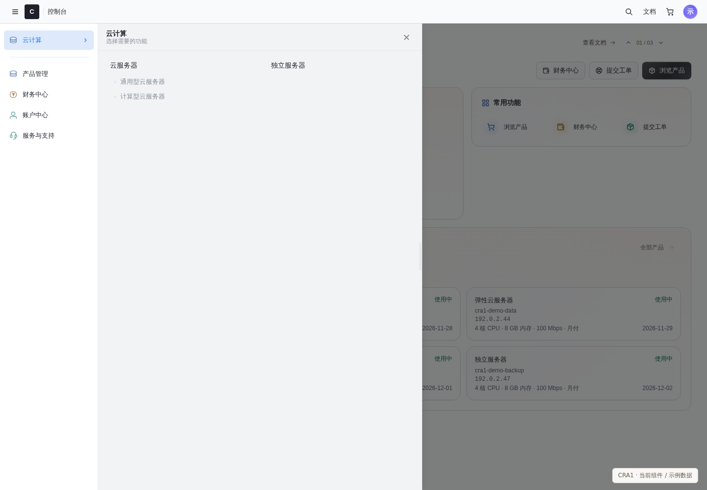
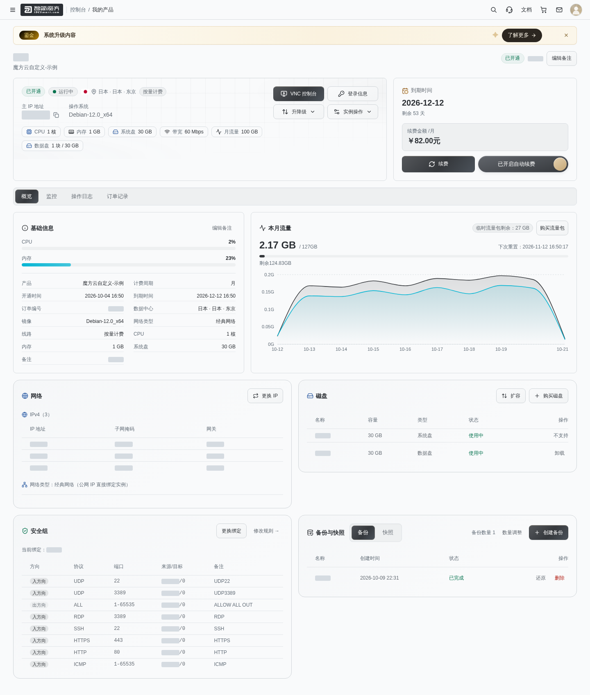
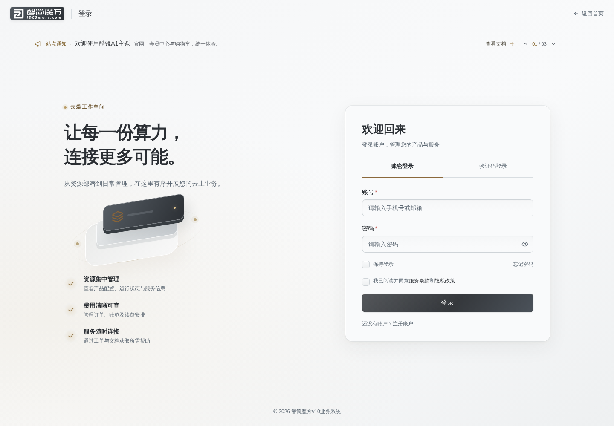
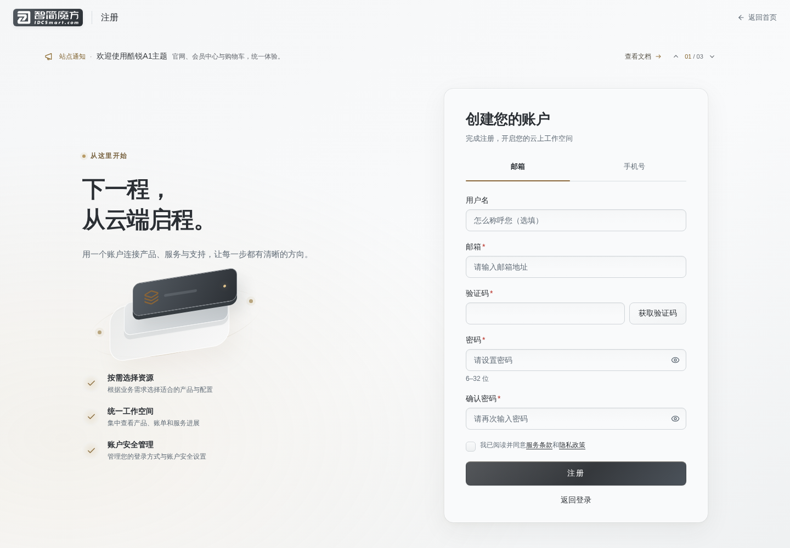
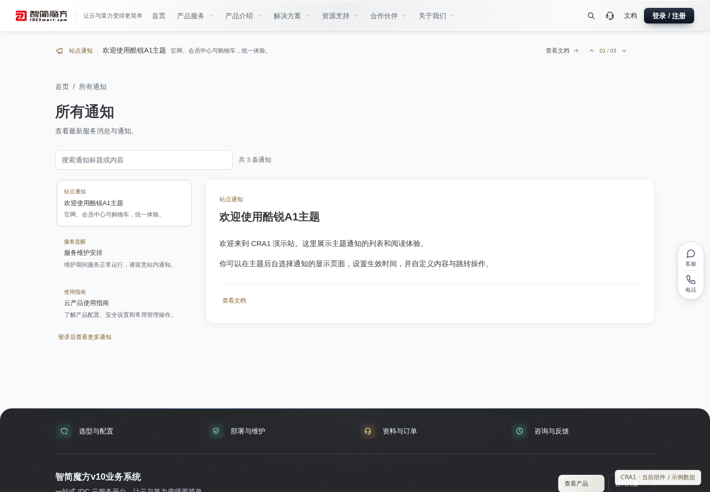

# 酷锐A1主题 · CRA1

酷锐A1主题（CRA1）是为 **智简魔方 V10 系统**设计的一套主题，覆盖官网、会员中心与购物车，采用钛灰银与香槟金配色，让品牌展示、客户服务与商品购买流程保持统一的视觉体验。

三个主题共用基础组件，并各自保留独立的内容设置和自定义 CSS / JavaScript。可在主题后台按页面编辑文案、图片与模块，通过拖拽调整菜单和条目顺序。

产品、订单、支付与账户等业务由智简魔方 V10 系统及已安装的模块、插件提供，具体可用功能以系统设置、模块兼容情况及账号权限为准。

## 下载与安装

当前版本：[**v17.4 测试版**](https://github.com/zbxh/cra1-theme-public/releases/tag/v17.4)。

[下载主题安装包](https://github.com/zbxh/cra1-theme-public/releases/download/v17.4/CRA1-theme-v17.4-install.zip)

主题需安装在已有的智简魔方 V10 系统上，当前测试基准为 V10 10.7.4、PHP 7.4 与 Nginx，网站需启用 HTTPS。其他系统或模块版本尚需验证，安装前请按教程确认环境。

安装包已包含运行所需资源，无需安装 Node.js 或自行编译。

- [安装与更新图文教程](docs/installation.md)：文件放置位置、安装向导、主题后台设置与覆盖更新。
- [主题使用教程](docs/usage.md)：页面编辑、公共设置、图片、菜单、草稿、预览和主题管理。
- [更新日志](https://github.com/zbxh/cra1-theme-public/releases)：在 Release 中查看每次发布的修复与优化。

**首次安装：**将下载的主题安装包 ZIP 上传到 **智简魔方 V10 网站根目录**解压，同名文件夹合并。以 V10 超级管理员身份登录系统，打开 `https://你的域名/cra1-install/`，按向导完成检查与安装。安装保留当前主题选择；先用设置的账号密码登录主题后台配置内容，再到 V10 系统后台手动启用需要的主题。

**已有安装的更新方式：**进入主题后台“主题管理 → 安装与更新”，直接上传同一个主题安装包 ZIP，检查通过后确认覆盖更新，无需解压或再次输入密码。配置、后台账号、密钥、媒体、草稿和页面独立内容会保留，无需卸载。浏览器上传受限时可使用折叠入口中的服务器本地导入。默认使用主题后台更新；后台暂时无法使用时，可先备份网站，完整解压覆盖安装包，再登录 V10 超级管理员并访问 `/cra1-install/` 完成更新，详见安装教程。当前不提供单独更新包或在线更新。

GitHub 自动生成的 **Source code** 压缩包用于源码开发，安装请使用上方的主题安装包，图文教程可直接在线阅读。

## 界面预览

以下展示主题的主要界面。会员中心、侧栏、控制面板与通知截图使用主题实际组件和示例数据，不含真实客户资料。

### 官网首页

### 会员中心首页

### 侧边栏导航

### 服务器控制面板

### 登录页面

### 注册页面

### 所有通知

## 开发

源码修改与构建方法见[开发与构建](cra1-theme/docs/开发与构建.md)。

## 许可

本项目采用 **酷锐A1主题源码可见商业许可证**，具体使用与商业授权条件见 [LICENSE](LICENSE)。源码可见不等于无限制免费商用。

官网页脚及主题后台底部须保留“主题：酷锐A1”及仓库链接；只有联系作者取得明确允许移除署名的付费书面授权后，才可删除。普通商业部署授权不自动包含去署名权利。
