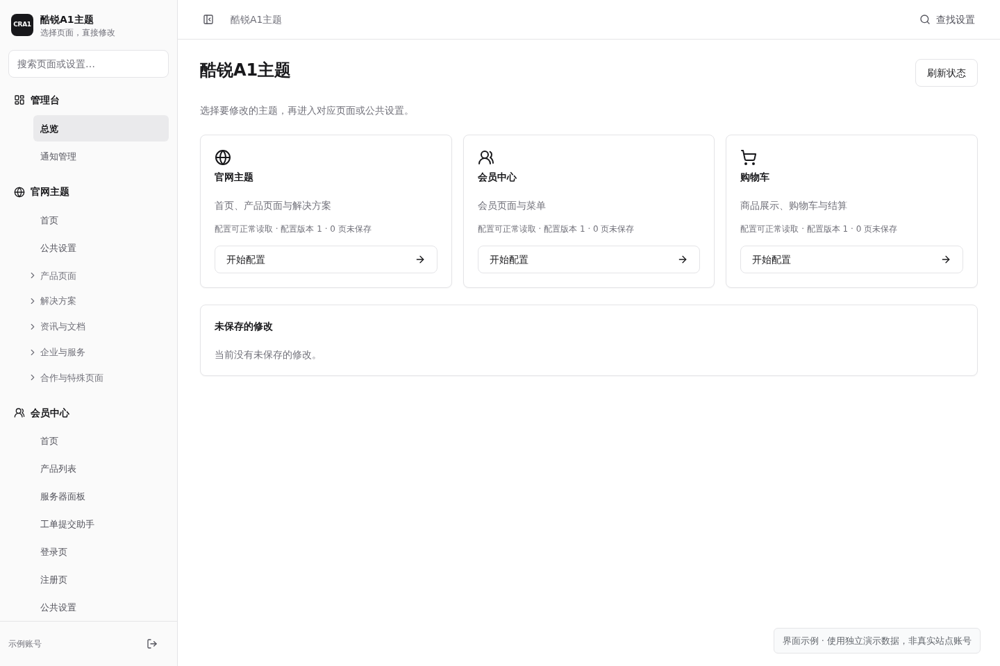

# 酷锐A1主题 · CRA1

**为智简魔方 V10 打造统一的官网、会员中心与购物车体验**

钛灰银与香槟金配色 · 桌面与手机适配 · 独立可视化主题后台

   

**[下载主题](https://github.com/zbxh/cra1-theme-public/releases/download/v17.4/CRA1-theme-v17.4-install.zip) · [在线演示](https://cra1.coorw.com/) · [主题后台](https://cra1.coorw.com/testadmin/) · [安装教程](docs/installation.md) · [使用文档](docs/usage.md)**

[功能亮点](#功能亮点) · [演示账号](#在线演示) · [界面预览](#界面预览) · [快速开始](#快速开始) · [交流与反馈](#交流与反馈)

## 关于 CRA1

酷锐A1主题是一套面向 **智简魔方 V10** 的网站主题，将品牌展示、客户服务与商品购买流程统一在同一套视觉风格中。官网、会员中心和购物车可按需启用，分别管理内容与外观。

通过独立主题后台编辑文案、图片、菜单和页面区块，先预览，再保存发布。商品、订单、支付与账户等业务由 V10 系统及已安装的模块、插件提供，具体功能以系统配置、模块兼容情况和账号权限为准。

## 功能亮点

- **🌐 官网展示**：配置首页、产品介绍、解决方案、资讯文档与企业页面，统一管理头部、页脚和客服入口。
- **👤 会员中心**：展示产品、账单、工单和账户入口，定制首页、登录注册页与多级侧栏菜单。
- **🛒 购物车**：统一商品浏览、配置选择、购物车与结算页面的视觉，承接已适配模块的原生订购流程。
- **🎨 可视化编辑**：使用中文表单修改图片、文案、图标与链接，对支持的区块调整显隐和顺序。
- **🧭 菜单与导航**：导入系统导航，配置三级菜单、关联商品、图标和排序，按启用插件匹配功能入口。
- **📣 页面通知**：统一管理三个主题的通知，设置显示页面、有效时间、优先级与关闭规则。
- **💾 配置与更新**：导入导出主题配置与菜单，预览差异、保留历史；上传完整安装包更新并保留已有设置。
- **📱 多端适配**：适配桌面与手机布局，提供独立页面内容、自定义 CSS / JavaScript 和编辑预览。

## 在线演示

演示站：[cra1.coorw.com](https://cra1.coorw.com/)

| 入口 | 登录信息 |
| --- | --- |
| [前台演示](https://cra1.coorw.com/) | 账号：`18888888888` 密码：`testkr123456` |
| [主题后台](https://cra1.coorw.com/testadmin/) | 账号：`testkr` 密码：`testkr123456` |

## 界面预览

点击图片查看大图。会员中心、侧栏、控制面板与通知截图使用主题实际组件和示例数据。

| 会员中心 | 主题后台 |
| :---: | :---: |
|  |  |
| **服务器控制面板** | **侧边栏导航** |
|  |  |

查看更多：登录、注册与通知页面

| 登录页面 | 注册页面 |
| :---: | :---: |
|  |  |

## 快速开始

### 1. 下载与环境

GitHub 当前提供 **[v17.4 测试版](https://github.com/zbxh/cra1-theme-public/releases/tag/v17.4)**，安装包已包含运行资源，无需安装 Node.js 或自行编译。

**[下载主题安装包](https://github.com/zbxh/cra1-theme-public/releases/download/v17.4/CRA1-theme-v17.4-install.zip)** · [查看更新日志](https://github.com/zbxh/cra1-theme-public/releases)

| 项目 | 当前测试基准 |
| --- | --- |
| 业务系统 | 已安装的智简魔方 V10 10.7.4 |
| 运行环境 | PHP 7.4、Nginx、HTTPS |
| 其他版本与模块组合 | 安装前按[图文教程](docs/installation.md)确认兼容性 |

### 2. 首次安装

1. 先备份网站，将完整安装 ZIP 上传到 **V10 网站根目录**解压，同名文件夹选择合并。
2. 在浏览器登录 V10 超级管理员，再打开 `https://你的域名/cra1-install/`，按向导完成检查并设置主题后台。
3. 登录主题后台，先配置文案、图片与菜单。
4. 内容准备好后，在 V10 系统后台手动启用需要的官网、会员中心和购物车主题，并核对手机端及会员首页设置。

详细目录与图文步骤见[安装与更新教程](docs/installation.md)。

### 3. 已有主题更新

进入主题后台 **“主题管理 → 安装与更新”**，直接上传同一份完整安装 ZIP，无需解压；检查通过后点击 **“确认覆盖更新”**，完成后刷新页面。配置、账号、密钥、图片、草稿和页面独立内容会保留。

浏览器上传受限或后台暂时不可用时，可按[安装教程](docs/installation.md#05-已有主题如何更新)使用服务器本地导入或备用解压覆盖流程。

GitHub 自动生成的 **Source code** 压缩包供源码开发使用，安装请选择上面的 `CRA1-theme-v17.4-install.zip`。首次安装与覆盖更新使用同一份安装包。

## 交流与反馈

- **QQ 交流群：603107399** · [点击加入](https://qm.qq.com/q/O3d7bVtcoS)
- **问题与建议：**[提交 GitHub Issue](https://github.com/zbxh/cra1-theme-public/issues/new/choose)，请附主题版本、相关页面和复现步骤。
- **使用与开发：**[使用文档](docs/usage.md) · [开发与构建](cra1-theme/docs/开发与构建.md)

## 许可

本项目采用 **[酷锐A1主题源码可见商业许可证](LICENSE)**，非商业使用、免费商用条件与商业授权范围以许可证为准。

官网公共页脚和主题后台底部须保留“主题：酷锐A1”及仓库链接；移除署名需取得明确允许的付费书面授权，普通商业部署授权不自动包含去署名权利。
