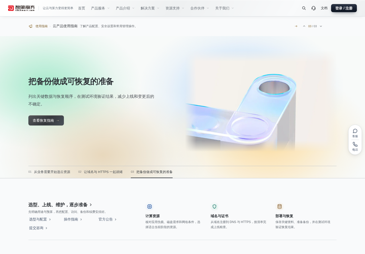
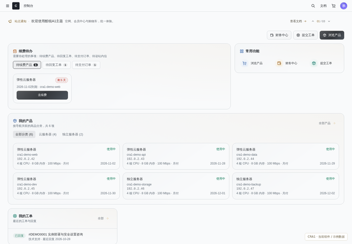
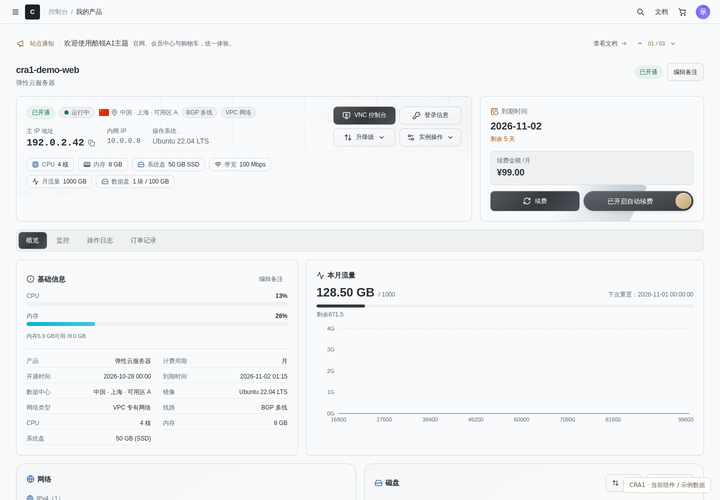
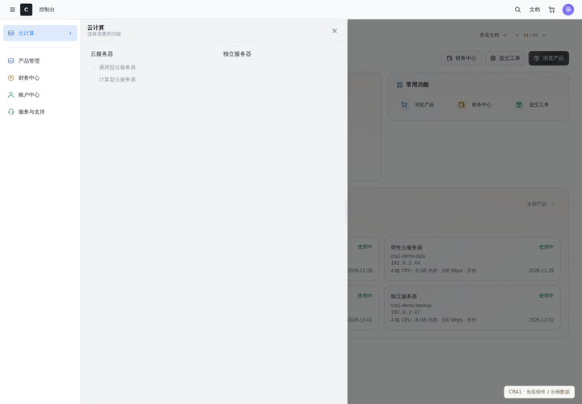
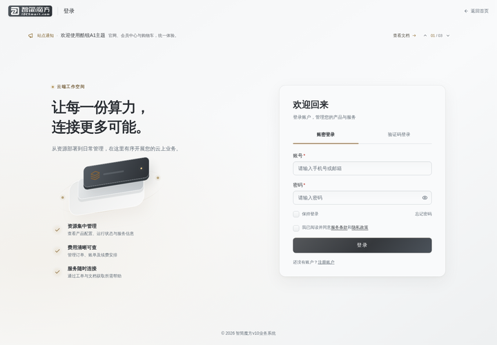
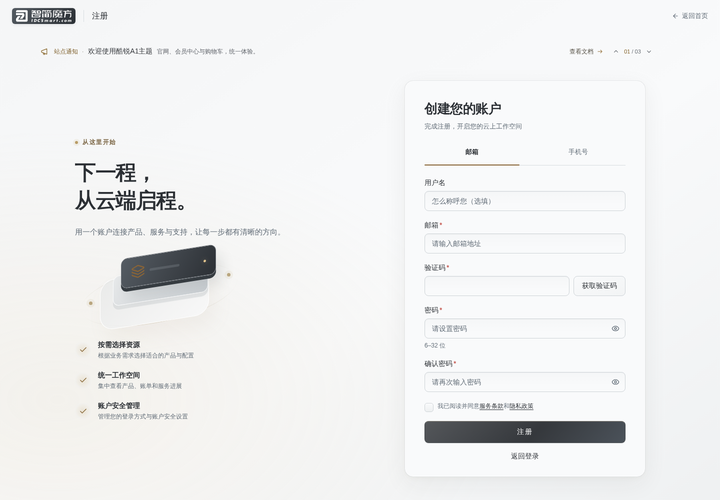
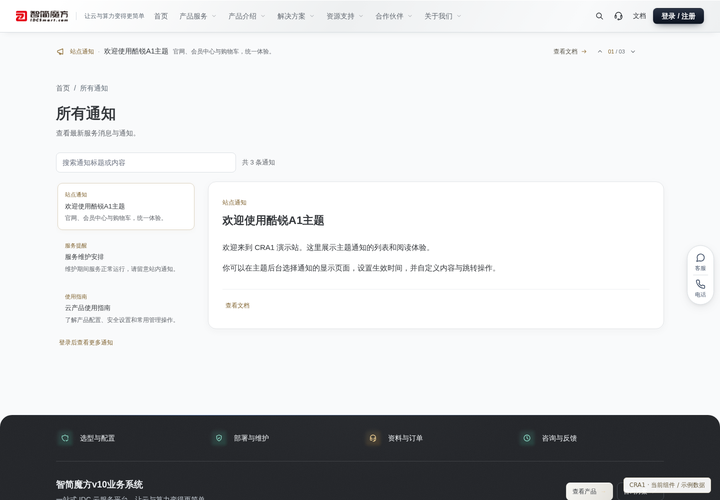
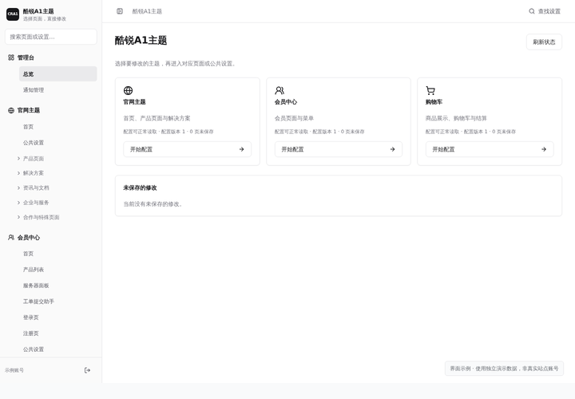

<div align="center">

# 酷锐A1主题 · CRA1

**为 V10 打造风格统一的官网、会员中心与购物车**

钛灰银与香槟金配色 · 可视化页面设置 · 三个主题独立管理

<p>
  <a href="https://github.com/zbxh/cra1-theme-public/releases/tag/v17.1"></a>
  <a href="#compatibility"></a>
  <a href="#compatibility"></a>
  <a href="LICENSE"></a>
  <a href="https://qm.qq.com/q/O3d7bVtcoS"></a>
</p>

<p>
  <a href="#screenshots">界面预览</a> ·
  <a href="#features">功能特性</a> ·
  <a href="#quick-start">快速安装</a> ·
  <a href="https://github.com/zbxh/cra1-theme-public/releases/download/v17.1/CRA1-theme-v17.1.zip">主题下载</a> ·
  <a href="#documentation">使用文档</a> ·
  <a href="#community">交流反馈</a>
</p>

</div>

---

## 📖 项目介绍

酷锐A1主题（CRA1）是一套面向 V10 的网站主题，覆盖官网展示、会员服务与商品购买流程。三个主题使用共用基础组件，统一按钮、表单、卡片、导航与弹窗的视觉风格，同时各自保留独立的内容设置和自定义 CSS / JavaScript。

日常维护通过主题后台完成：按页面修改文案、图片与模块，使用列表和拖拽调整菜单、条目及顺序，预览后统一保存。安装包已包含运行资源，安装时无需 Node 或自行编译。

<a id="screenshots"></a>

## 🖼️ 界面预览

以下按当前版本重新截图。官网、登录与注册页来自匿名页面；会员中心、侧栏、控制面板、通知和后台使用真实主题组件配合示例数据，不包含真实客户资料。点击图片可查看大图。

| 官网首页 | 会员中心 |
| :---: | :---: |
| [](docs/images/preview-website.png) | [](docs/images/preview-member.png) |
| **服务器控制面板** | **侧边栏导航** |
| [](docs/images/preview-server-panel.png) | [](docs/images/preview-sidebar.png) |

| 登录页面 | 注册页面 |
| :---: | :---: |
| [](docs/images/preview-login.png) | [](docs/images/preview-register.png) |
| **所有通知** | **主题后台** |
| [](docs/images/preview-notifications.png) | [](docs/images/preview-admin.png) |

<a id="features"></a>

## ✨ 功能特性

| 模块 | 主要能力 |
| --- | --- |
| 官网主题 | 首页、产品、解决方案、资讯与文档页面；支持页面独立内容、公共区块、搜索及客服入口 |
| 会员中心 | 产品列表、服务器控制面板、财务与工单入口；提供最近访问、快捷操作及资源状态展示 |
| 购物车 | 商品分类、参数选配、镜像与存储配置、购物车与结算；保留 V10 商品定价及业务规则 |
| 登录与注册 | 手机号／邮箱识别、账密与手机验证码登录；按系统设置展示注册渠道、验证码与兼容官方接口的第三方登录 |
| 可视化后台 | 按页面组织设置，中文表单、图片选择、条目拖拽与显示开关；支持草稿、冲突保护及按需预览 |
| 主题通知 | 在三个主题中批量或单独选择显示页面，支持开始／到期时间、轮播、详情弹窗与所有通知页 |
| 共用组件 | 银灰边缘光、淡金点缀与统一控件；适配桌面、平板与手机，并响应减少动效设置 |
| 安装与维护 | 安装向导、独立主题后台、兼容检查、上传更新及备份回退；更新保留已有主题内容 |

业务能力由实际安装的 V10、模块和插件提供。主题承接其接口与流程，具体入口以系统启用状态及账号权限为准。

<a id="quick-start"></a>

## 🚀 快速安装

当前提供 **v17.1 测试版**。首次安装和后续手动覆盖更新使用同一份安装包：

| 场景 | 下载与说明 |
| --- | --- |
| 主题下载 | [安装包与图文教程合集](https://github.com/zbxh/cra1-theme-public/releases/download/v17.1/CRA1-theme-v17.1.zip)，包含安装 ZIP、PDF / HTML / Markdown 教程及示意图 |
| 在线阅读 | [安装图文教程](docs/installation.md) · [主题使用教程](docs/usage.md)，直接在 GitHub 阅读 Markdown |
| 查看变化 | [版本发布与更新说明](https://github.com/zbxh/cra1-theme-public/releases) |

1. 备份现有网站文件、数据库与配置，下载并在电脑上解压安装合集。
2. 阅读合集中的图文教程，将里面的 `cra1-theme-install.zip` 上传至 **V10 网站根目录**解压。
3. 按教程配置目录保护，登录 V10 超级管理员后打开安装向导。
4. 完成环境检查，设置主题后台入口与独立账号，安装后进入主题后台编辑页面。

完整步骤见 [安装与更新图文教程](docs/installation.md)。GitHub 自动生成的 **Source code** 压缩包用于源码开发，安装请使用上表中的安装合集。

**已经安装主题：**在电脑上解压同一份合集，到主题后台“主题管理 → 安装与更新”上传里面的 `cra1-theme-install.zip`，预检后确认覆盖更新。保留原配置、后台账号、密钥、媒体、草稿和页面覆盖，无需卸载，也不要在服务器直接解压覆盖。当前不提供单独更新包或在线更新。

<a id="compatibility"></a>

## 🧩 环境与更新

| 项目 | 当前测试基准 |
| --- | --- |
| V10 | 10.7.4 |
| 运行环境 | Nginx、PHP 7.4、HTTPS |
| 服务器模块 | MfCloud 4.3.0、MfDcim 4.2.1 |
| 通用商品模块 | IdcsmartCommon 4.3.1 |

安装前由向导检查实际环境与文件；其他系统或模块版本需单独确认。仍为 V10 10.7.2 的站点，请先通过官方流程升级。

主题维护限定在主题自有文件中。V10 与模块仍通过官方流程更新；更新后可在主题后台重新检查兼容性，具体处理见 [更新与回退](docs/installation.md#08-后续更新与回退)。

<a id="documentation"></a>

## 📚 使用文档

| 文档 | 内容 |
| --- | --- |
| [安装与更新图文教程](docs/installation.md) | 首次安装、目录保护、主题后台设置、更新与回退 |
| [主题使用教程](docs/usage.md) | 官网、会员、购物车设置，以及菜单、通知、草稿与自定义代码 |
| [开发与构建](cra1-theme/docs/开发与构建.md) | 源码目录、依赖安装、构建入口与打包方式 |
| [版本更新说明](https://github.com/zbxh/cra1-theme-public/releases) | 各版本实际交付的修复与优化 |

<a id="development"></a>

## 🛠️ 源码与开发

```text
cra1-theme/
├── backend/              主题后端与兼容适配
├── source/member/        会员中心源码
├── source/admin/         主题后台源码
└── scripts/              统一构建与打包脚本
public/
├── web/cra1/             官网模板与样式
├── clientarea/           会员中心模板
├── cart/                 购物车模板
├── cra1-shared/          共用组件与基础样式
└── cra1-install/         安装向导
docs/                    安装及使用教程
```

开发构建使用 Node 22、Python 3 与 PHP 7.4，通过 `cra1-theme/scripts/build.mjs` 统一输出到站外暂存目录。具体命令见 [开发与构建](cra1-theme/docs/开发与构建.md)。

<a id="community"></a>

## 💬 交流与反馈

- **QQ 交流群：603107399** · [点击加入](https://qm.qq.com/q/O3d7bVtcoS)
- **问题反馈：**[提交 Issue](https://github.com/zbxh/cra1-theme-public/issues/new)，请说明页面、复现步骤、浏览器及主题／系统版本，并附打码截图。
- **功能建议：**[参与讨论](https://github.com/zbxh/cra1-theme-public/issues)，欢迎交流使用体验与改进想法。

请勿在反馈中附带账号密码、验证码、令牌、密钥或未脱敏的客户资料。

## 📄 许可

本项目采用 **酷锐A1主题源码可见商业许可证**，具体使用与商业授权条件见 [LICENSE](LICENSE)。源码可见不等于无限制免费商用。
