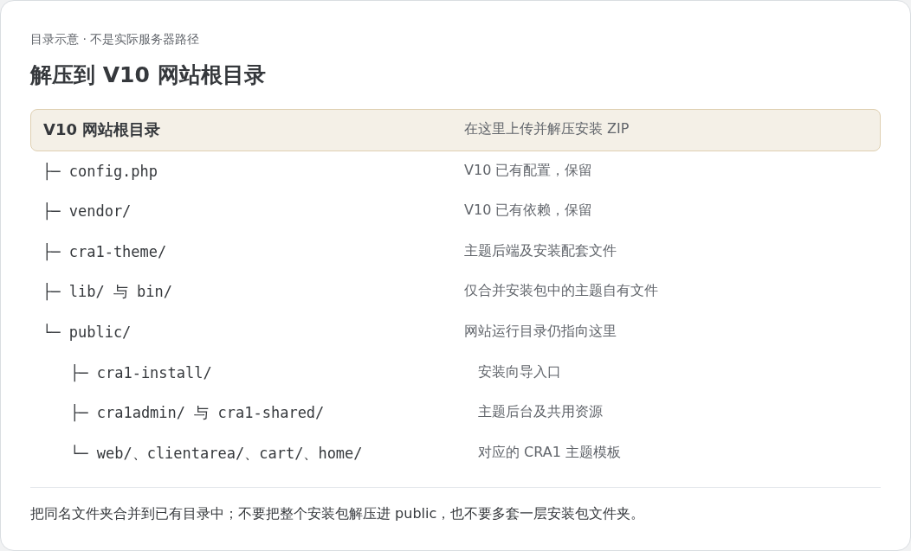
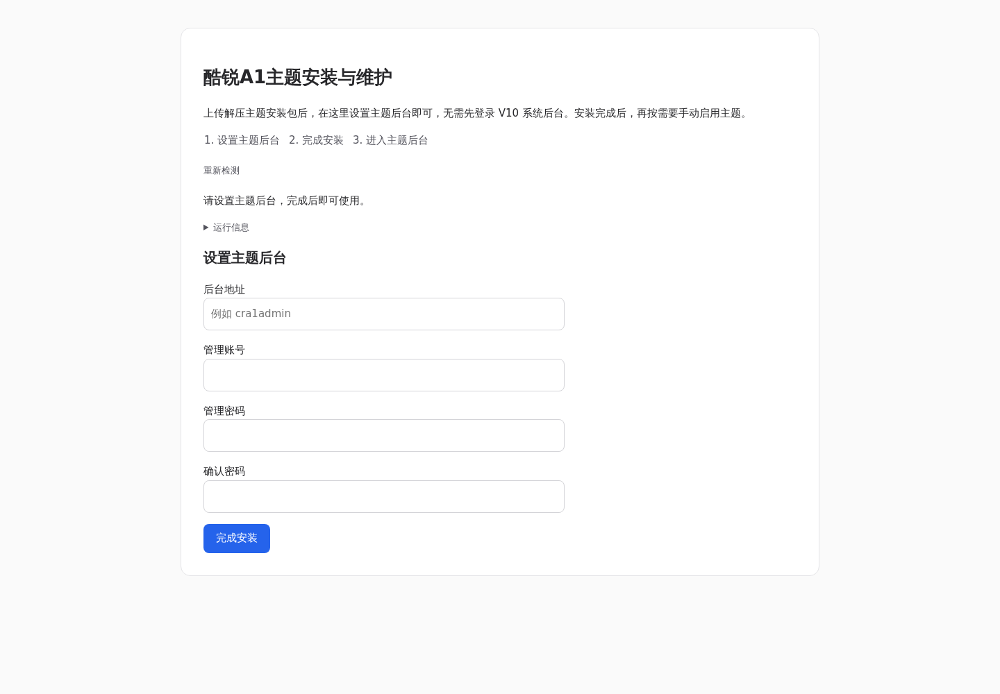
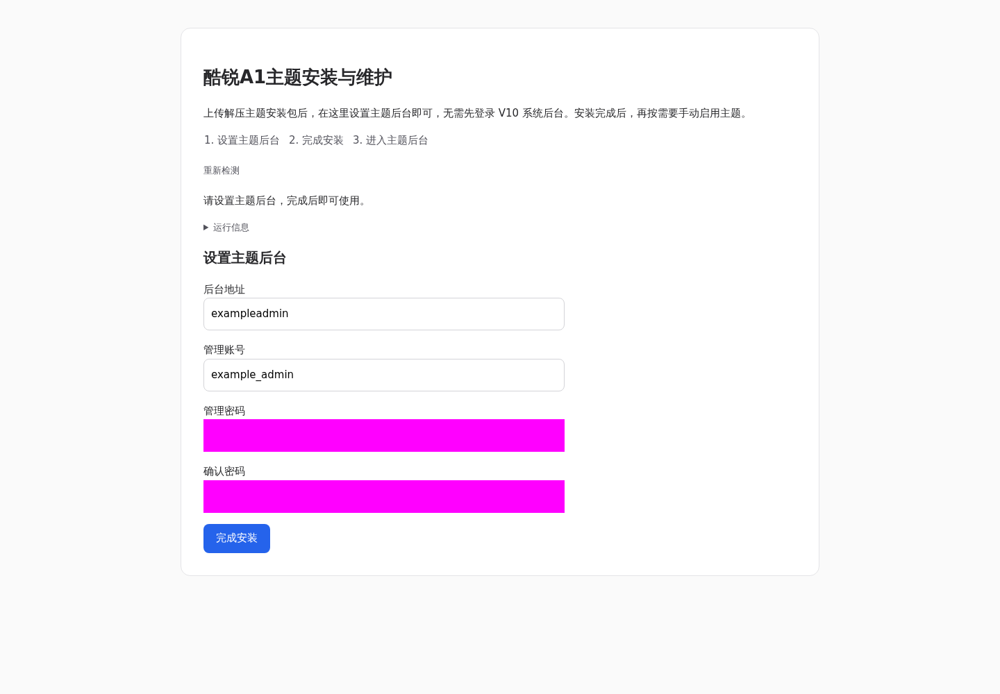
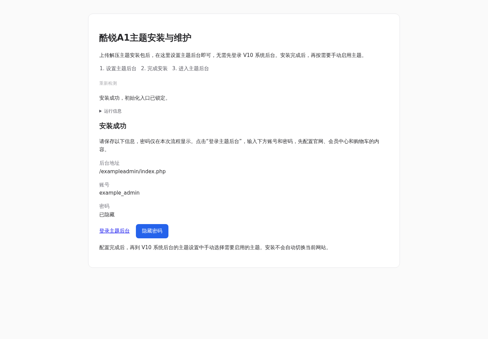
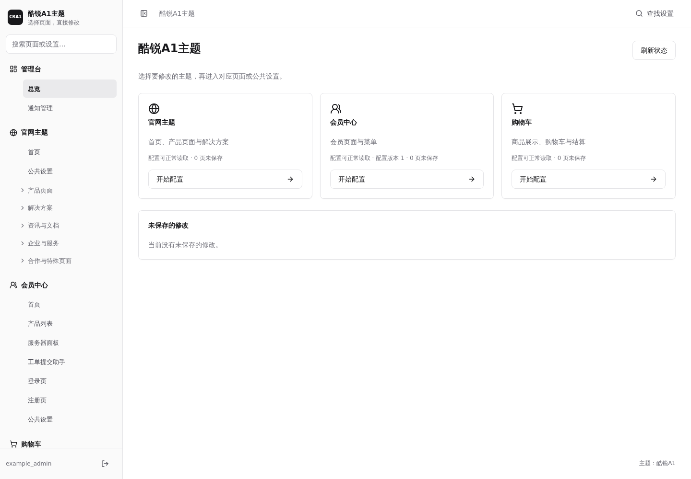
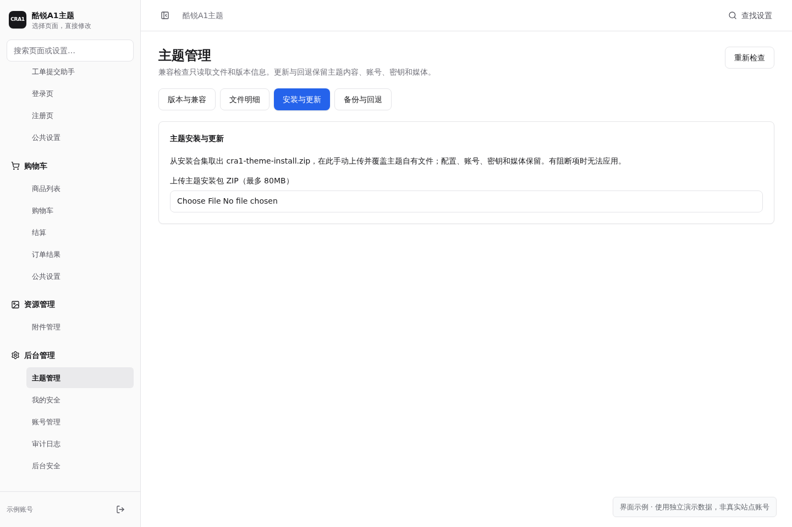
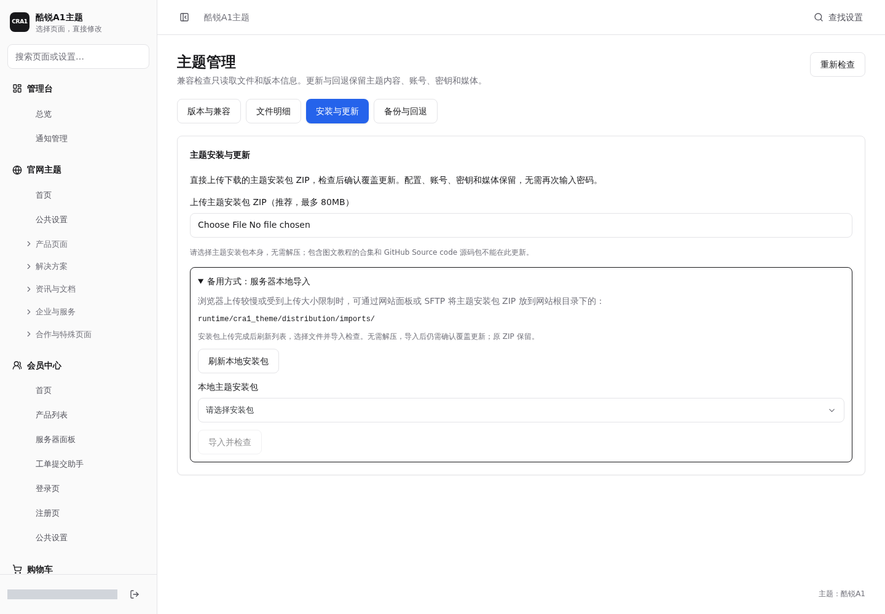
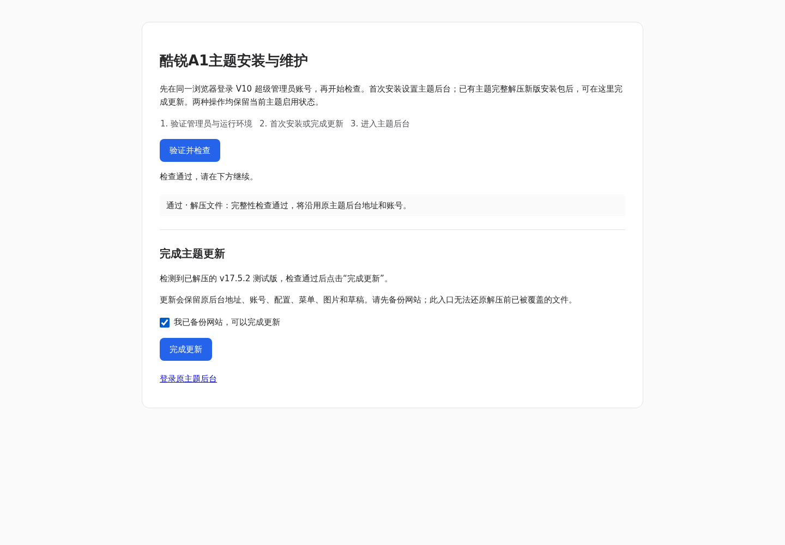

# 酷锐A1主题安装图文教程

适用：**v17.7.0 测试版 · 智简魔方 V10 10.7.4**。

**QQ 交流群：603107399** · [点击加入](https://qm.qq.com/q/O3d7bVtcoS)

## 01 下载主题包

[下载主题安装包](https://github.com/zbxh/cra1-theme-public/releases/download/v17.7.0/CRA1-theme-v17.7.0-install.zip)。下载得到的 **`CRA1-theme-v17.7.0-install.zip`** 就是可直接上传的主题安装包，无需再从教程合集中提取。图文步骤直接阅读本页。

首次安装按下面步骤操作；已经安装过主题，直接看[已有主题如何更新](#05-已有主题如何更新)。操作前先备份网站。

安装或更新失败时，页面会说明失败步骤、原因及参考编号。若提示目录权限不足，请按页面列出的具体位置和 PHP 运行账号调整；不要将整站设为 777。页面会明确说明是否已恢复原版本，未确认前不要重复初始化。

## 02 主题文件放到哪些目录

首次安装时，打开智简魔方 V10 的**网站根目录**，也就是能看到 `config.php`、`vendor/`、`public/` 的那一层。将主题安装包 ZIP 上传到这一层并解压，**同名文件夹选择合并**。

安装包已经排好目录，整包解压后会自动放到以下位置。也可以先在电脑上解压，再按表上传、合并。

| 内容 | 对应位置（相对 V10 网站根目录） |
| --- | --- |
| 主题程序 | `cra1-theme/` |
| 官网主题 | `public/web/cra1/` |
| 会员中心主题 | `public/clientarea/template/pc/cra1/`<br>`public/clientarea/template/mobile/cra1/` |
| 购物车主题 | `public/cart/template/pc/cra1/`<br>`public/cart/template/mobile/cra1/` |
| 会员首页主题 | `public/home/template/pc/cra1/`<br>`public/home/template/mobile/cra1/` |
| 共用组件 | `public/cra1-shared/` |
| 主题后台 | `public/cra1admin/` |
| 安装向导 | `public/cra1-install/` |



注意：解压位置是 **V10 网站根目录**，不是 `public/` 里面；不要额外套一层安装包文件夹。

若向导提示权限不足，只需在网站面板检查提示中的对应路径：程序目录通常为 `755`、文件为 `644`；需要写入的目录还应允许本站 PHP 运行用户写入。不要将整站设为 `777`。

## 03 打开安装向导

解压后直接在浏览器打开，无需先登录 V10 系统后台：

```text
https://你的域名/cra1-install/
```

使用 HTTP 的网站将地址中的 `https://` 换成 `http://`。将“你的域名”换成本站域名，向导会自动准备页面，直接显示“设置主题后台”表单。仅核对 PHP、必要扩展和数据库连接；运行信息默认收起，有问题时才展开说明。HTTP 和 HTTPS 网站均可安装，使用本站平时访问的地址即可。反向代理或 CDN 不需要额外登记域名或代理白名单才能登录主题后台。



## 04 设置主题后台并完成安装

1. 填写主题后台地址（6–32 位小写字母和数字，以字母开头）、管理账号（3–32 位字母、数字、下划线或短横线）、密码与确认密码（12–128 个字符）。网站地址自动识别，无需填写。
2. 点击 **“完成安装”**，按钮显示“正在安装…”后等待完成。若填写有误，按字段旁的提示修改；若网络中断或等待超时，先点击“重新检测”确认是否已安装，避免重复提交。安装会保留网站当前的主题选择。



安装成功后，保存页面显示的**后台地址、账号和密码**，点击 **“登录主题后台”**，输入刚才设置的账号和密码。主题后台账号和 V10 系统后台账号独立。安装失败时，页面会显示具体失败步骤、原因和参考编号，请按提示处理后重新检测。



进入主题后台后，选择“官网”“会员中心”或“购物车”，先编辑文案、图片、菜单和其他内容。主题尚未启用也可以登录后台、保存配置。

首次安装的会员菜单附带“产品管理、财务中心、账户中心、服务与支持”四个一级分组，可在“会员中心 → 公共设置 → 菜单”调整。缺少的插件入口会隐藏，商品分类按本站系统导航的明确商品关联，无法匹配时隐藏。更新已有安装不会覆盖原菜单或其他主题数据。



内容准备好后，再进入 **V10 系统后台的主题设置**，按需要手动启用酷锐A1的官网、会员中心和购物车主题；同时核对对应的手机端及会员首页设置。安装完成不会自动切换网站，也不要求同时启用三个主题。

教程中的域名与账号均为示例，密码已隐藏或遮盖，请填写自己的信息。

## 05 已有主题如何更新

主题后台 **“主题管理 → 安装与更新”** 中，可以先点击 **“检查最新版本”**，查看更新内容，再点击 **“一键更新至对应版本”**。确认后服务器会下载安装包，备份并完成更新，保留已有配置和账号。测试版可勾选“包含测试版”。成功后刷新页面；在线连接不可用时，使用下方手动方式。

服务器无法直连 GitHub 时，可在同页填写 **“GitHub 加速链接前缀”**，例如 `https://加速域名/`，再点击“保存加速设置”或“检查最新版本”。程序自动拼接原 GitHub 地址；清空后恢复直连。若加速服务不支持版本查询，会尝试直连查询，安装包仍使用加速地址下载；均不可用时可继续手动上传。

下载主题安装包 ZIP，进入主题后台 **“主题管理 → 安装与更新”**，直接上传该 ZIP，**不要解压**。上传进度到 100% 后等待检查结果，通过后点击 **“确认覆盖更新”**；当前更新流程不再要求重复输入后台密码。



更新会保留已有配置、后台账号、图片、草稿和页面内容，无需重新安装。内容未变的文件会自动跳过；主题辅助程序位于 `cra1-theme/` 内，不要求修改 V10 的 `bin/`、`lib/` 目录权限。默认使用后台上传；无法使用时，可选择下面的备用方式。

### 浏览器上传较慢时：服务器本地导入

1. 展开更新页面中的 **“备用方式：服务器本地导入”**。
2. 通过网站面板或 SFTP，将同一个主题安装包 ZIP 上传到网站根目录下的 `runtime/cra1_theme/distribution/imports/`，无需解压。
3. 等文件上传完成，点击 **“刷新本地安装包”**，选择 ZIP，再点 **“导入并检查”**。
4. 检查通过后点击 **“确认覆盖更新”**。导入不会自动更新，也不会删除原 ZIP。



默认使用页面上传。本地导入仅用于上传较慢或服务器限制浏览器上传大小的情况；不要选择包含图文教程的合集或 Source code 源码包。若旧版后台仍弹出密码确认，按旧版提示完成本次更新，刷新后使用新的流程。

### 备用方式：解压覆盖后完成更新

主题后台暂时无法使用，或希望通过网站面板覆盖文件时：

1. **先备份网站文件和数据库**。使用同一份主题安装包 `CRA1-theme-v17.7.0-install.zip`，将它完整解压到 V10 **网站根目录**，同名目录选择合并、同名文件选择覆盖。目录位置与首次安装相同，不要删除原主题目录或旧资源。
2. 在同一浏览器登录本站 **V10 超级管理员**，打开 `https://你的域名/cra1-install/`，点击 **“重新检测”**。
3. 向导识别已有安装后，显示“完成主题更新”。确认已经备份，勾选 **“我已备份网站，可以完成更新”**，再点击 **“完成更新”**；无需重新填写后台地址、账号或密码。
4. 看到“更新完成”后，点击 **“登录主题后台”**，继续使用原地址和原账号，并刷新前台页面。配置、菜单、图片、草稿和主题启用状态会保留。



只覆盖文件还没有完成更新，必须访问上述入口确认；页面显示“主题已是当前版本”时无需重复操作。文件不完整时，重新完整解压**同一份安装包**再检查。网络中断或等待超时，先点“重新检测”确认状态，不要反复提交；若显示有未完成的更新，先点“恢复未完成的更新”，然后重新检查。

若更新失败，保留现有文件和备份，不要删除主题数据或重新初始化账号。先按提示处理对应目录或 PHP 缓存问题，再重新检查；联系作者时提供页面上的失败步骤、原因和参考编号即可，无需发送账号密码。更新不会重设主题后台密码，登录时继续使用原主题后台地址及独立账号；已绑定找回邮箱的账号也可使用登录页的“忘记密码”。

此方式无法自动找回解压前已覆盖的文件。更新事务的恢复和版本回退不会撤销此前的手工覆盖；需要完整恢复时，使用解压前的网站备份。后台上传更新仍是日常首选。

日常设置方法见[主题使用教程](https://github.com/zbxh/cra1-theme-public/blob/main/docs/usage.md)。

## 停用与卸载主题

超级管理员可在主题后台的“主题管理 → 停用与卸载”中选择：

- **停用并保留数据**：将正在使用酷锐A1的页面切回官方默认模板，停止主题扩展，保留配置、素材及独立后台账号。重新使用时，在同一位置点击“检查并重新启用”；若停用后又在 V10 后台改过主题，系统会提示核对，不会覆盖新的选择。
- **完整卸载**：检查范围、确认文字并重新验证身份后，切回官方模板，将主题程序、后台、配置及主题上传的图片和头像移出当前站点。客户、产品、订单、付款、工单、官方模板、第三方插件及系统公共上传文件保持原样。

没有独立的手机官方默认模板时，会关闭手机独立模板，使用电脑模板的自适应页面。官方电脑模板缺失或目录权限不足时，会说明具体位置并停止执行。

完整卸载保留非公开备份，结果页会显示相对网站根目录的备份位置。备份含账号、密钥和上传内容，仅供服务器管理员读取，应下载到安全位置妥善保存。确认无需恢复后，再由服务器管理员清理备份。卸载不会自动销毁备份。

卸载中断或需要恢复时，由服务器管理员使用结果页列出的备份内 `recover.php`；恢复程序不会覆盖已存在的文件。恢复后保留原账号和配置，主题会话全部失效，需要重新登录；网站继续使用当前系统主题，可再从主题后台检查并重新启用。
