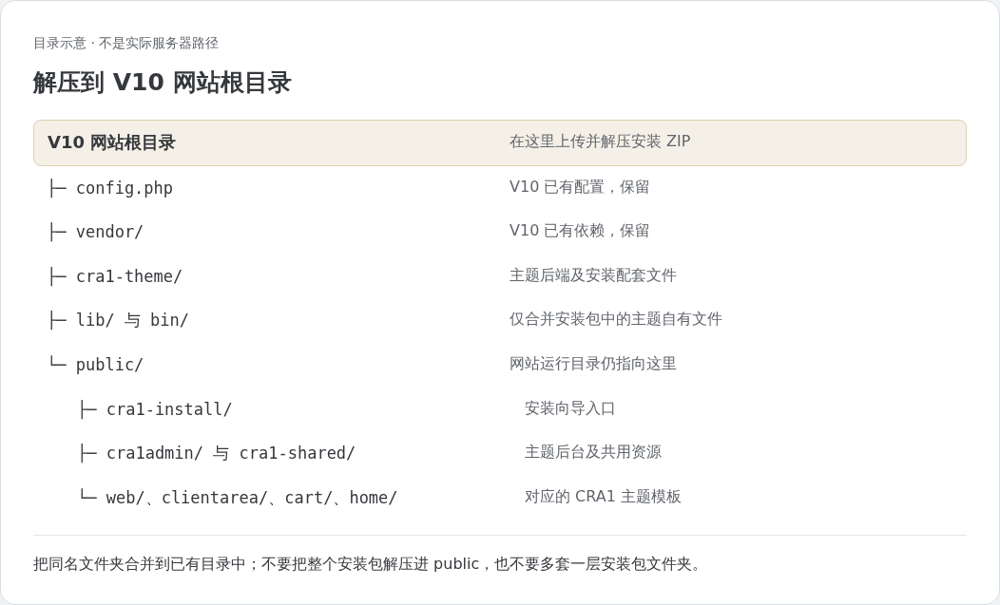
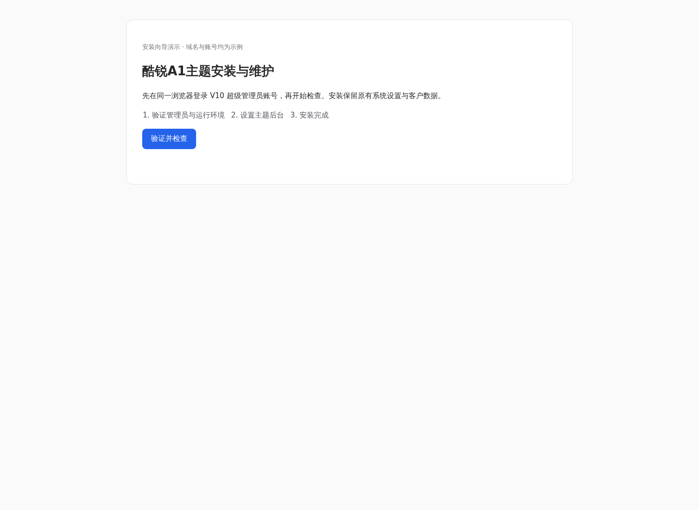
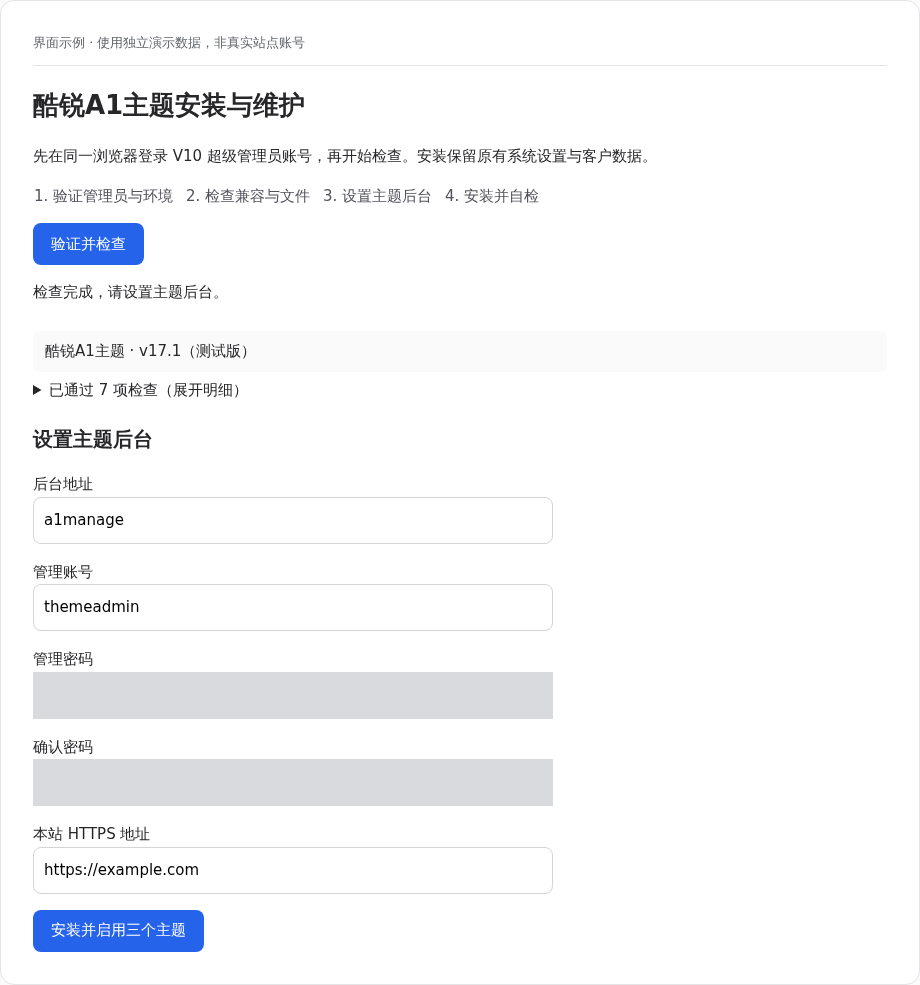
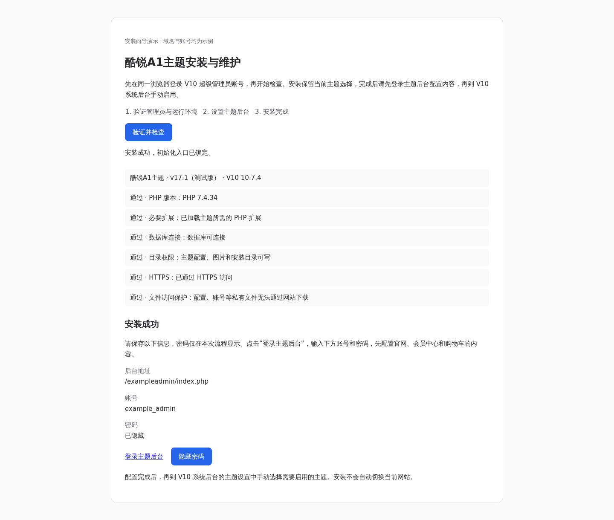
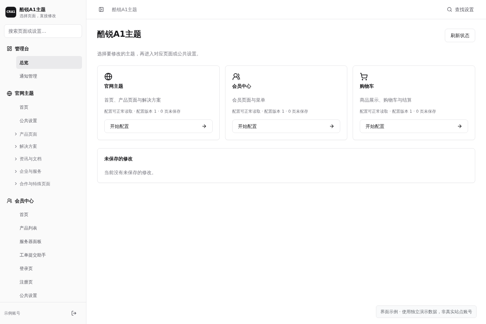
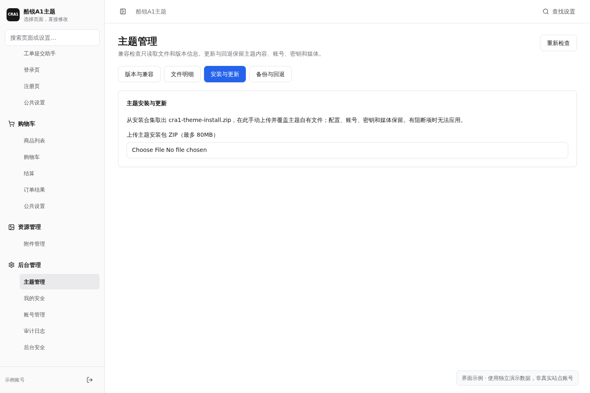
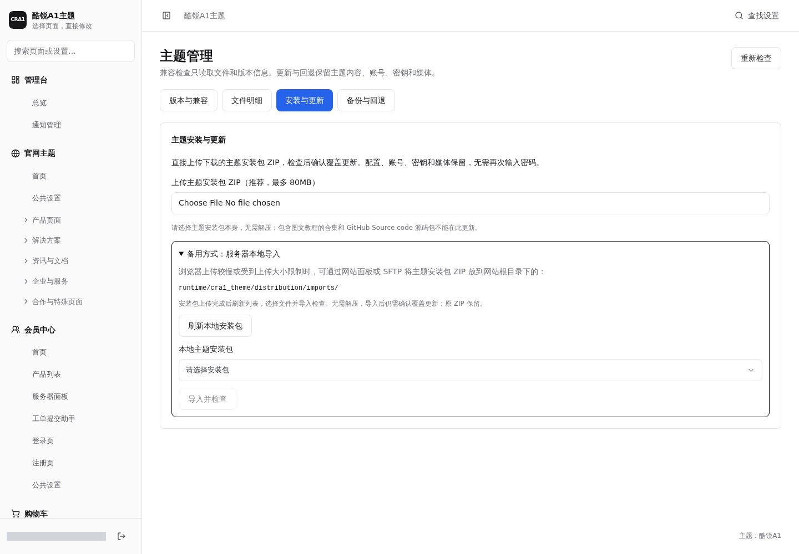

# 酷锐A1主题安装图文教程

适用：**v17.3 测试版 · 智简魔方 V10 10.7.4**。

**QQ 交流群：603107399** · [点击加入](https://qm.qq.com/q/O3d7bVtcoS)

## 01 下载主题包

[下载主题安装包](https://github.com/zbxh/cra1-theme-public/releases/download/v17.3/CRA1-theme-v17.3-install.zip)。下载得到的 **`CRA1-theme-v17.3-install.zip`** 就是可直接上传的主题安装包，无需再从教程合集中提取。图文步骤直接阅读本页。

首次安装按下面步骤操作；已经安装过主题，直接看[已有主题如何更新](#05-已有主题如何更新)。操作前先备份网站。

## 02 主题文件放到哪些目录

首次安装时，打开智简魔方 V10 的**网站根目录**，也就是能看到 `config.php`、`vendor/`、`public/` 的那一层。将主题安装包 ZIP 上传到这一层并解压，**同名文件夹选择合并**。

安装包已经排好目录，整包解压后会自动放到以下位置。也可以先在电脑上解压，再按表上传、合并。

| 内容 | 对应位置（相对 V10 网站根目录） |
| --- | --- |
| 主题程序 | `cra1-theme/` |
| 官网主题 | `public/web/cra1/` |
| 会员中心主题 | `public/clientarea/template/pc/cra1/`<br>`public/clientarea/template/mobile/cra1/` |
| 购物车主题 | `public/cart/template/pc/cra1/`<br>`public/cart/template/mobile/cra1/` |
| 会员首页主题 | `public/home/template/pc/cra1/`<br>`public/home/template/mobile/cra1/` |
| 共用组件 | `public/cra1-shared/` |
| 主题后台 | `public/cra1admin/` |
| 安装向导 | `public/cra1-install/` |



注意：解压位置是 **V10 网站根目录**，不是 `public/` 里面；不要额外套一层安装包文件夹。

若向导提示权限不足，只需在网站面板检查提示中的对应路径：程序目录通常为 `755`、文件为 `644`；需要写入的目录还应允许本站 PHP 运行用户写入。不要将整站设为 `777`。

## 03 打开安装向导

先在浏览器登录本站的 **智简魔方 V10 超级管理员**账号，再在同一浏览器打开：

```text
https://你的域名/cra1-install/
```

将“你的域名”换成本站域名，点击 **“验证并检查”**。向导检查 PHP、必要扩展、数据库连接、目录权限和 HTTPS，运行环境可用后显示“设置主题后台”表单。文件访问诊断仅在确实发现私有测试文件能被下载时阻止安装；回源失败或跳转等无法确认的情况会显示提示，可以继续安装。



## 04 设置主题后台并完成安装

1. 填写主题后台地址（6–32 位小写字母和数字，以字母开头）、管理账号（3–32 位字母、数字、下划线或短横线）、密码与确认密码（12–128 个字符）。本站 HTTPS 地址保留向导自动填写的当前网站地址，不带页面路径，不要改成其他域名。
2. 点击 **“完成安装”**，按钮显示“正在安装…”后等待完成。若填写有误，按字段旁的提示修改；若网络中断或等待超时，先点击“验证并检查”确认是否已安装，避免重复提交。安装会保留网站当前的主题选择。



安装成功后，保存页面显示的**后台地址、账号和密码**，点击 **“登录主题后台”**，输入刚才设置的账号和密码。主题后台账号和 V10 系统后台账号独立。



进入主题后台后，选择“官网”“会员中心”或“购物车”，先编辑文案、图片、菜单和其他内容。主题尚未启用也可以登录后台、保存配置。



内容准备好后，再进入 **V10 系统后台的主题设置**，按需要手动启用酷锐A1的官网、会员中心和购物车主题；同时核对对应的手机端及会员首页设置。安装完成不会自动切换网站，也不要求同时启用三个主题。

教程中的域名与账号均为示例，密码已隐藏或遮盖，请填写自己的信息。

## 05 已有主题如何更新

下载主题安装包 ZIP，进入主题后台 **“主题管理 → 安装与更新”**，直接上传该 ZIP，**不要解压**。上传进度到 100% 后等待检查结果，通过后点击 **“确认覆盖更新”**；当前更新流程不再要求重复输入后台密码。



更新会保留已有配置、后台账号、图片、草稿和页面内容，无需重新安装。内容未变的文件会自动跳过；主题辅助程序位于 `cra1-theme/` 内，不要求修改 V10 的 `bin/`、`lib/` 目录权限。已有主题请通过后台上传更新，不要直接在服务器解压覆盖。

### 浏览器上传较慢时：服务器本地导入

1. 展开更新页面中的 **“备用方式：服务器本地导入”**。
2. 通过网站面板或 SFTP，将同一个主题安装包 ZIP 上传到网站根目录下的 `runtime/cra1_theme/distribution/imports/`，无需解压。
3. 等文件上传完成，点击 **“刷新本地安装包”**，选择 ZIP，再点 **“导入并检查”**。
4. 检查通过后点击 **“确认覆盖更新”**。导入不会自动更新，也不会删除原 ZIP。



默认使用页面上传。本地导入仅用于上传较慢或服务器限制浏览器上传大小的情况；不要选择包含图文教程的合集或 Source code 源码包。若旧版后台仍弹出密码确认，按旧版提示完成本次更新，刷新后使用新的流程。

日常设置方法见[主题使用教程](https://github.com/zbxh/cra1-theme-public/blob/main/docs/usage.md)。
