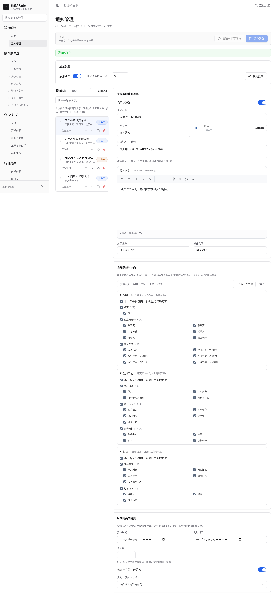
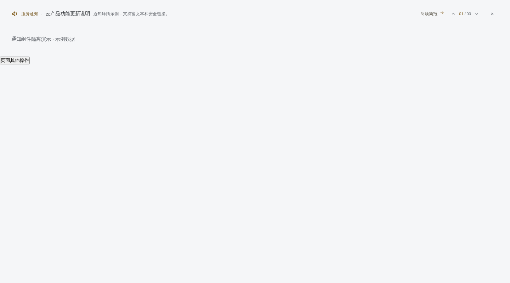
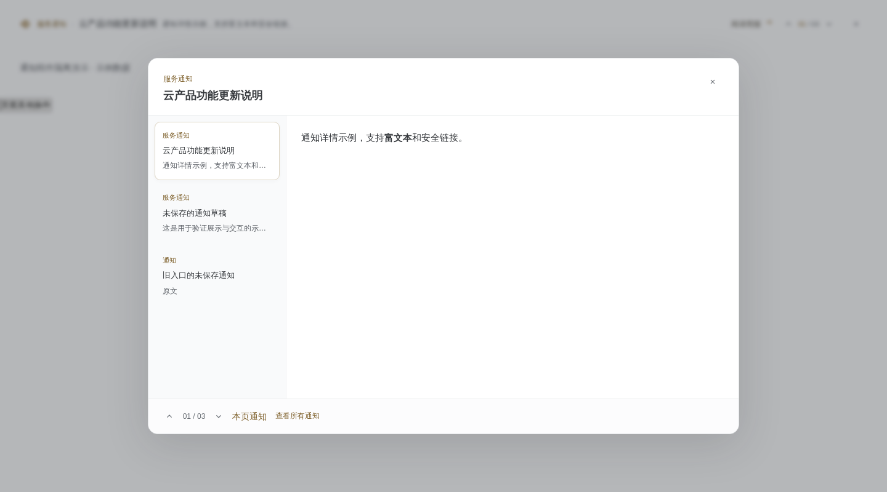
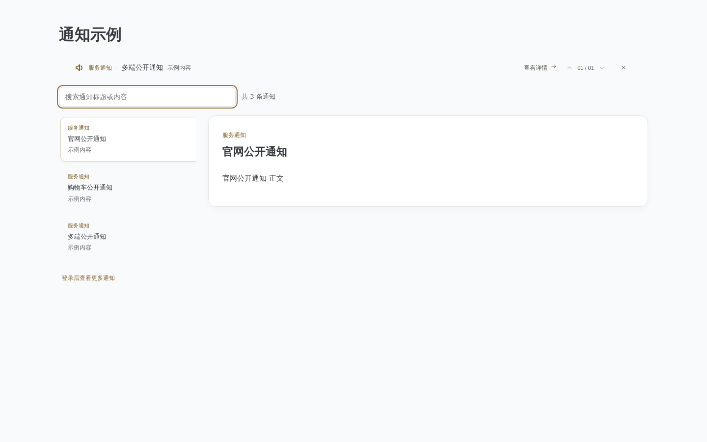
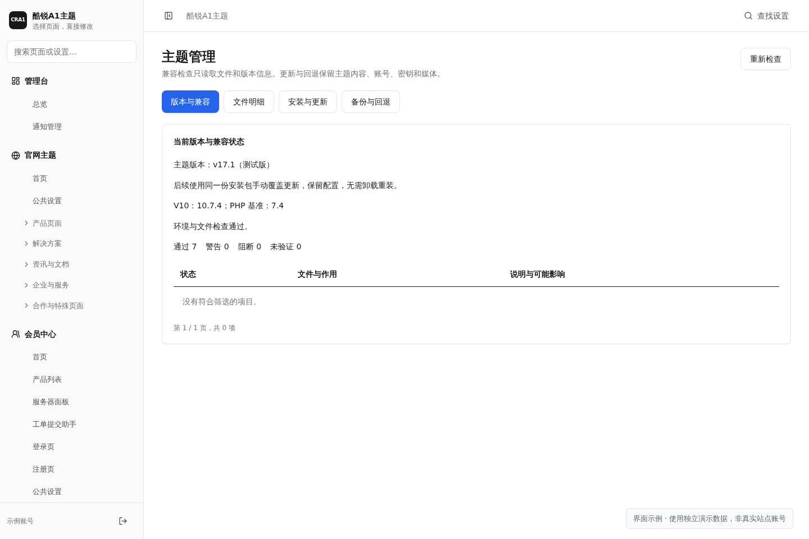

# 酷锐A1主题使用教程

安装完成后，使用安装时设置的主题后台地址、账号和密码登录，先配置内容。主题后台独立运行，官网、会员中心和购物车尚未启用时也可以编辑和保存；准备好后，再到 V10 系统后台的主题设置中手动启用需要的主题。

适用版本：**v17.2 测试版**。当前版本可在“主题管理 → 版本与兼容”查看。

尚未安装时，先按[安装与更新教程](installation.md)操作。

## 1. 登录与两个后台的分工

打开安装成功页保存的主题后台地址，使用安装时自定义的主题账号和密码登录。主题后台账号与 V10 管理员、前台会员账号分别管理。

| 要修改的内容 | 操作位置 |
| --- | --- |
| 页面文案、图片、区块、主题菜单和主题外观 | 酷锐A1主题后台 |
| 商品、价格、计费周期、库存、服务器模块及业务规则 | V10 系统后台 |
| 新闻、公告、文档、工单和插件业务资料 | V10 系统后台对应功能或插件 |
| 主题资源版本、更新、回退和文件检查 | 主题后台 → 主题管理 |

公告中心使用 V10 公告插件的分类、内容和排序，支持分类浏览、搜索与分页。分类暂时无法读取时，可以先查看全部公告，并使用“重试分类”恢复分类入口。主题顶栏的通知和公告插件分别管理；点击站内信会进入对应的消息详情。文件下载列表沿用系统的登录要求，未登录时先进入登录页。

顶栏的搜索、客服、账户、消息和语言菜单支持按 Esc 收起，并返回对应入口；手机端也可使用同样的键盘操作。登录状态变化或页面隐藏时，会清空并收起顶栏搜索结果，重新打开即可继续搜索。会员中心操作弹窗关闭后，键盘焦点会回到打开它的按钮；弹窗内下拉选项展开时，先按一次 Esc 只收起选项。

首次登录若提示修改初始密码，请进入“我的安全”完成修改。不同主题管理账号的权限不同；没有显示的管理入口应由有权限的管理员操作。

## 2. 找到要修改的位置

侧栏的“官网主题”“会员中心”“购物车”是三个平级入口。修改哪个页面，就进入该主题下的对应页面；修改头部、菜单等共用部分，则进入对应主题的“公共设置”。

桌面端在编辑区左侧选择区块，手机端使用下拉选择器。侧栏的“查找设置”支持中文页面名、区块名、设置名和旧入口名；也可按 `Ctrl + K` 或 `⌘ + K` 搜索。

当前页面会自动定位并展开所属分类。可收藏后台的具体页面链接，刷新及浏览器前进、后退会保留页面定位。

## 3. 修改页面并保存

以官网首页为例：

1. 进入“官网主题 → 首页”。
2. 从区块清单选择轮播图、产品、解决方案等实际可编辑部分。
3. 修改中文表单中的标题、说明、图片或按钮。
4. 对支持显隐和排序的区块，使用显示开关、上移／下移或拖拽手柄调整。
5. 点击“预览效果”查看，确认后点击顶部的“保存……”按钮。

当前页的内容、区块顺序、显隐和页面搜索设置通过同一次保存提交。保存成功后再到前台刷新确认。固定区块会说明支持的修改范围，未提供的排序或显隐控件表示当前模板不支持该项调整。

### 编辑重复条目

轮播、优势、价格、问答等使用条目卡片或列表。使用“添加”“编辑”“删除”和拖拽手柄管理内容；支持隐藏的条目可单独关闭。拖拽手柄也支持键盘操作：聚焦后按空格抓取，按方向键调整，按 Esc 取消。

弹窗中的“应用到草稿”或确认只更新页面草稿，仍需点击页面保存按钮。弹窗中点击取消会丢弃这次弹窗修改。

### 图片、图标和链接

图片控件可上传图片或选择已有图片，并显示缩略图；需要使用已有图片地址时展开对应选项。主题内容图片单文件上限为 5MB，具体格式以选择器提示为准。

图标通过图形选择器选择。链接选择器提供的站内页面、商品、联系方式或外部链接由当前字段决定；页内导航应选择当前页面的区块。支持格式化的文案可使用简单富文本工具。

站点名称等由系统管理的信息会显示当前值及系统设置入口，请在对应的 V10 设置中修改。

## 4. 草稿、撤销与配置冲突

未保存页面会出现标记，总览中也会列出这些页面。在当前浏览器标签页切换页面、切换主题或刷新时会保留草稿；草稿不等于已经发布。退出登录会清除草稿，关闭标签页或清理浏览器存储也可能使草稿丢失。

“撤销当前页修改”恢复当前页最近一次读取或保存的内容，不撤销其他页面的草稿。账号、安全表单不作为页面内容草稿保存。

遇到“服务器配置有更新”时，本地修改会保留。在差异弹窗中逐项选择“保留我的修改”或“使用服务器值”，点击“合并到草稿”，检查后再次保存。直接选择“使用服务器配置”会放弃当前页本地差异。

若提示“配置已保存，前台同步失败”，使用“重试前台同步”。不要反复重新录入内容。

## 5. 公共默认与页面独立内容

官网的产品与解决方案页面可以独立修改内容。修改当前页不会同步改写其他页面；公共默认用于尚未单独修改的页面。

“官网主题 → 公共设置 → 通用内容”会显示引用页面，并可查看哪些页面正在采用公共值、模板专属值或独立设置。修改公共内容前，先核对实际影响范围。

页面中的“恢复默认设置”可分别恢复当前区块内容、显示状态或当前页顺序。恢复默认内容会删除当前页对应的覆盖，重新使用模板预置或公共内容；它不会重写公共内容。恢复后也需要保存。

“清空内容”和“恢复默认”含义不同：清空是明确不显示这段内容，恢复默认是重新继承。根据控件提供的操作选择。

## 6. 官网主题

官网包含首页、产品、解决方案、资讯与文档、企业与服务、合作及特殊页面。两个旧页面地址映射到正式页面，使用正式入口编辑即可。

进入“公共设置”，从主体左侧选择：

| 设置 | 主要用途 |
| --- | --- |
| 头部 | 头部文字、导航菜单、客服信息 |
| 底部 | 品牌介绍、菜单、服务承诺、友情链接、备案、版权和二维码 |
| 悬浮工具 | 显示开关、工具条目、联系方式和跳转目标 |
| 通用内容 | 多页使用的默认文案和条目 |
| 搜索引擎默认设置 | 默认标题、说明等；具体页面可单独覆盖 |
| 自定义 CSS / JS | 作用于官网全部页面的样式与脚本 |

官网公共页脚的“主题：酷锐A1”链接与商家版权文字分别显示；底部设置中的版权及显隐选项只管理商家内容。主题后台的署名位于主体内容底部。

### 设置客服下拉内容

进入“公共设置 → 头部 → 客服信息”。启用客服图标后，添加分组和条目，选择电话、邮件、社交账号、普通文本或链接等类型。可分别开关文字、图标及单条内容，使用图标选择器和链接选择器调整。

电话、邮件等类型会自动处理对应动作；编辑弹窗会说明点击后的操作。拖拽可调整顺序或把条目移动到其他分组。应用到草稿后，统一保存头部设置。

### 管理页面通知

进入左侧“管理台 → 通知管理”，这里统一管理官网、会员中心和购物车的通知。原来的“会员中心公共设置 → 公告”和官网“顶部信息条”入口会定位到这里。

1. 点击“添加通知”，填写标题、分类文字，选择图标；简短说明与标题在同一行显示，留空时自动提取通知内容的纯文本。正文可使用文字格式、列表、颜色和链接。
2. 选择文字操作：打开详情、跳转链接，或不显示操作文字。
3. 在“通知条显示页面”中勾选一个或多个页面，可按主题、分类批量选择，也可以搜索页面。“本主题全部页面”会包含以后新增的页面；单独勾选只针对选中的页面类型。文章和服务器详情不需要逐个选择具体记录。
   选择任意有效的官网或购物车页面后，该通知无需登录即可查看；仅选择会员中心页面时，登录后才可查看。后台会自动说明可见范围，无需另设开关。通知条、本页通知和所有通知使用同一规则；未登录时的搜索与数量只包含公开通知。
4. 按站点时区设置开始时间和到期时间。开始时间留空即刻开始；到期时间留空长期有效。
5. 设置优先级和关闭规则。多条通知先按优先级从高到低排列，同级按列表顺序轮播；使用拖拽手柄或上移、下移按钮排序。
6. 点击“预览效果”选择主题、页面与桌面或手机尺寸，确认后使用页面唯一的“保存通知”按钮保存全部修改。

通知正文与索引均为透明、无外框样式，索引位于关闭按钮左侧：

通知在鼠标悬停、键盘操作、查看详情及页面进入后台时暂停自动切换；移开后继续剩余计时。点击计数器可查看当前页全部有效通知。只有一条通知时也显示上下箭头，此时箭头不可切换。系统设置为减少动效时，使用箭头手动切换。

详情弹窗将标题、正文和底部操作分开，长正文在弹窗内滚动。底部可切换上一条、下一条和查看本页通知。电脑端的本页通知采用左侧标题列表、右侧正文；手机端选择标题后进入详情，点击“本页通知”返回列表。

允许关闭的通知可设置为本次访问不再显示、当天不再显示，或本条内容更新前不再显示。排序、优先级和其他通知的修改不会清除本条关闭记忆。没有匹配通知时，页面自动收起通知区域。

旧通知会保留原来的显示范围、内容及详情链接。会员首页的文章时间轴由 V10 的新闻、公告或帮助文档提供，在会员首页设置中单独管理，与主题通知相互独立。

如果页面提示检测到旧通知入口的未保存草稿，点击“恢复旧通知草稿”，检查内容和显示范围后再保存。恢复草稿不会自动发布。

“本页通知”弹窗中的“查看所有通知”会打开独立的所有通知页面（站点路由 `/notifications.html`）。该页可搜索并阅读当前身份可见的生效通知，也能查看之前关闭过的有效通知。官网和购物车通知无需登录；仅在会员中心显示的通知需要登录后查看。停用、尚未开始或已经到期的通知不会展示；退出登录后会清除已加载的会员专用通知。

## 7. 会员中心

### 登录、注册与第三方账号

在主题后台进入“会员中心 → 登录页”或“会员中心 → 注册页”，可分别修改表单标题与说明、页面 Logo、左侧介绍文案与配图、介绍条目、支持链接和页脚。介绍条目沿用列表编辑、显隐与拖拽排序；点击“预览效果”可查看未保存内容，最后使用当前页的保存按钮统一保存。

两页使用主题的银灰与淡金配色。电脑端显示左右两栏，手机端收起介绍区；关闭“显示左侧介绍”后表单居中。Logo 未选择时使用系统 Logo，配图未选择时使用内置插图，页脚留空时使用系统版权文字。支持链接可选择站内页面，也可使用邮件、电话等联系方式。

登录方式、注册渠道、密码规则、图形验证码和服务协议地址在 V10 系统后台设置。登录页将邮箱密码与手机密码合并为“账密登录”，账号框填写手机号或邮箱后自动识别；大陆手机号校验 11 位数字，其他地区按所选国际区号处理。手机验证码登录独立展示，未开放的登录方式不能提交。停止手机注册不会影响已有用户通过手机号找回密码。

第三方登录使用 V10 的 OAuth 插件列表、名称和图标，启用兼容官方接口的插件后即可出现入口。允许浏览器打开授权窗口，完成授权后返回；首次登录按提示关联账户。微信扫码、普通账户和其他第三方登录入口可以同时显示，第三方账号的关联与解绑在账户安全设置中操作。

页面最上方显示 Logo、当前账户页面名称和返回首页，通知条紧随其下。表单中的国际区号、语言、销售人员与自定义选择字段统一使用主题下拉组件，支持键盘选择及 Esc 取消。表单支持密码显示切换、国际区号、注册自定义资料及系统启用的销售关联。登录页的“保持登录”使用系统原生登录时效，不在浏览器保存明文密码。

| 入口 | 可以调整的内容 |
| --- | --- |
| 登录页、注册页 | 两页各自的表单文案、Logo、左侧介绍、配图、条目、支持链接和页脚 |
| 首页 | 活动推荐、待办、常用功能、文章时间轴和账户安全概览 |
| 产品列表 | 列表标题、说明，以及具体菜单分类的文案覆盖 |
| 服务器面板 | 当前提供的面板展示设置，例如订单记录 |
| 工单提交助手 | 问题分类、部门、描述模板、教程链接及关联产品要求 |
| 公共设置 → 菜单 | 多级菜单、关联产品、图标、顺序、显隐与分界线 |
| 公共设置 → 外观 | 当前提供的会员外观选项 |

### 产品分类与侧栏菜单

产品分类以导航关联的产品为依据。先在 V10 后台的导航管理中确认分类与商品关联，再在主题会员菜单中选择对应导航、产品类别或商品；不要用服务器模块名称代替实际业务分类。

会员侧栏可使用“新增分界线”分隔订购入口与产品管理、财务等入口。分界线放在一级菜单之间，可排序、隐藏或删除。

菜单树与前台位置一一对应：一级分组是左侧主导航入口，二级分组是展开面板内的标题，三级页面是分组内的链接。一级、二级分组可以暂不填写链接，三级页面需要有效地址；拖拽时最多保留三级。

“导入系统导航”将系统的父菜单和子菜单放入“产品与服务”一级分组，保留原有父子关系、顺序和关联商品。覆盖导入会替换整棵菜单草稿；“仅追加系统新增项”保留已有名称、图标、显隐、顺序和移动后的位置。导入后先检查草稿，点击“保存菜单配置”才会在前台生效，保存前可以撤销。此过程不会修改 V10 系统导航。

产品列表配置按会员侧栏的真实分组、上下级和顺序展示，点击分组箭头可展开或收起。全局默认单独列在顶部；每个产品列表入口可以编辑独立文案，或停用独立设置以使用全局默认。菜单层级和顺序在“公共设置 → 菜单”调整。修改入口文案不会改变商品归类。

插件未安装、停用或无相应数据时，应先在 V10 后台确认该功能是否可用。

### 设置首页文章时间轴

进入“会员中心 → 首页 → 公告时间轴”，填写“前台标题”和可选的补充说明，再选择新闻、公告或帮助文档作为内容来源，选择该来源的分类及最多显示条数。切换来源会将分类重置为“全部分类”，避免误用另一来源的分类。

内容在 V10 对应插件中发布和管理，主题按插件实际公开内容显示；“更多”和文章详情会进入对应来源。帮助文档沿用原生分类及文章顺序，接口没有提供发布日期时不显示日期。插件停用时前台不显示该区块，后台保留原设置。

修改后点击首页的保存按钮，统一保存当前页全部修改。已有配置继续使用原来的标题、分类和新闻来源。

### 产品信息刷新与操作

服务器面板中的磁盘、网络和流量等内容分别刷新。后台刷新暂时失败时，页面保留已显示的内容并自动重试；首次读取失败时，可在对应区域点击“重试”。读取失败不表示资源已经被删除或尚未开通。

执行实例操作后，对应状态和相关内容会更新。若提交超时或结果尚未确认，先查看实例状态或操作日志，再决定是否重试，避免重复提交。

购买数据盘时，提交过程中不能重复点击或关闭弹窗。若提交结果无法确认，关闭、重新打开或刷新后仍会保留提醒；请先查看订单记录，找不到对应订单时联系客服核实。已取得订单号的订单可以继续处理，支付完成或订单结束后点击“查询订单状态”更新结果，再进行下一次购买。

调整 IP 防御时，必须等当前 IP 和目标档位的报价读取成功后才能提交；询价失败可点击“重新询价”。切换 IP 或档位会重新读取价格，降配需要阅读不退款提醒。

按需实例的自动释放是定时删除：即使余额充足、实例正常使用，到达设置的时间仍会删除实例，数据不可恢复。保存前会再次显示实例标识和包含时区的完整时间，请提前备份；“取消自动释放”可撤销原有定时设置。

工单详情首次读取失败时，页面提供“重新加载”和“返回工单列表”；成功读取前不能回复或关闭工单。已打开的工单若暂时刷新失败，会保留当前内容。

## 8. 购物车

“商品列表”负责商品卡片和选配区域，包含标题与说明、卡片排列、卡片显示内容、默认商品、选配区域和标题图标等区块。购物车、结算、订单结果分别有各自入口。

在“商品列表 → 标题图标”可选择支持自定义的选配标题图标；镜像、存储等业务参数和计费方式仍以 V10 商品及模块配置为准。

商品名称、价格、周期、地区、镜像顺序、磁盘计费规则和库存等业务数据应在 V10 后台调整。主题只提供对应展示与操作，不另存一份价格或服务器配置。

若价格计算器提示无法获取付款周期，请先在 V10 后台检查该商品的周期与定价，再重试；不要将尚未确认的价格当成免费。

报价尚未返回或读取失败时，金额显示为“—”，确认报价前不能结算。此时请按页面提示重新获取报价；有效报价为 0 元的商品仍按正常流程处理。

购物车为空时的内容和推荐商品在“购物车”入口编辑；结算与订单结果文案在各自页面编辑。推荐商品通过商品选择器绑定。

### 订单付款

核对订单并提交后，会进入独立收银台。财务中心、充值及主题提供的产品续费、升降配等付款入口也使用该页面。支付方式、可用余额和抵扣规则以系统实际返回为准。

使用线下转账时，先按收款说明付款，再上传凭证；显示“凭证正在审核”时，请等待审核结果。点击“我已付款”只会查询结果，不会直接将订单改成已付款。

付款完成后可返回来源页面或查看订单详情。若跳转失败但订单已经创建，请继续支付当前订单；提示暂时无法确认下单结果时，先到财务中心核对，避免重复提交。

## 9. 自定义 CSS / JavaScript

三个主题各自的“公共设置 → 自定义 CSS / JS”都包含代码区和独立启用开关。代码只作用于该主题的全部页面；修改官网代码不会同步修改会员或购物车。

保存前可使用预览检查效果，确认代码与当前页面兼容后再启用和保存。主题后台本身使用独立的样式与脚本。

## 10. 预览与正式页面

“预览效果”展示当前页及相关公共设置的草稿，可切换桌面和手机尺寸。官网使用真实主题模板，会员与购物车使用组件及示例数据。

预览不会保存页面内容，也不能执行真实下单、支付或服务器操作。若加载失败，点击重试或刷新预览。正式页面显示已保存内容，必须保存后再到前台核对。

## 11. 主题管理、更新与回退

“后台管理 → 主题管理”包含四个页面：

| 页面 | 操作 |
| --- | --- |
| 版本与兼容 | 查看当前主题、V10、PHP 及环境检查结果 |
| 文件明细 | 查看差异文件、作用、影响和处理建议 |
| 安装与更新 | 上传安装合集内的 cra1-theme-install.zip，检查后覆盖更新 |
| 备份与回退 | 查看历史记录，恢复中断更新或回退可用版本 |

更新前先备份网站和数据库，从 [主题下载](https://github.com/zbxh/cra1-theme-public/releases/download/v17.2/CRA1-theme-v17.2.zip) 获取同一份安装合集，在电脑上解压，然后上传里面的 `cra1-theme-install.zip`。查看文件检查结果后点击“确认覆盖更新”，按提示输入当前主题后台密码。

后台完整覆盖安装包内的主题自有文件，并保留配置、账号、密钥、媒体、草稿和页面覆盖；不要在服务器直接解压覆盖已有安装，无需卸载重装。没有单独的更新包，当前也不提供在线更新。

V10 和模块升级继续走官方流程。升级后重新检查主题兼容性，根据明细更新对应主题资源，不用旧系统文件覆盖新系统。主题更新步骤见[已有主题如何更新](installation.md#05-已有主题如何更新)。

## 12. 常见问题

| 现象 | 处理方式 |
| --- | --- |
| 后台修改后前台没有变化 | 确认已保存、主题及页面选对，检查是否提示同步失败，再刷新浏览器缓存 |
| 公共内容修改后某页没变化 | 查看该页是否使用独立覆盖或模板专属内容；需要重新继承时恢复对应区块默认内容 |
| 内容被清空后又显示默认文案 | 核对使用的是明确清空还是恢复默认；检查实际保存结果 |
| 找不到自定义代码、更新或账号管理入口 | 使用有权限的主题管理员账号登录 |
| 商品价格或计费周期不正确 | 在 V10 商品／模块设置中核对业务数据，不要在主题文案里手填价格代替 |
| 主题后台登录失败 | 使用安装时创建的独立主题账号，不要混用 V10 管理员或会员账号 |
| 未登录或登录过期后跳到登录页 | 重新登录会员账号后继续；提交订单前再次核对商品和报价 |
| 页面提示网络异常、请求超时或访问频繁 | 检查网络，稍后使用对应区域的重试入口；已提交的操作先确认结果，避免反复点击 |
| 更新后仍显示旧界面 | 先确认主题管理中的版本，再刷新缓存并检查资源加载；不要覆盖旧版本资源目录 |
| 文件检查出现阻断或未验证 | 查看文件明细，备份后按建议处理；不要强制覆盖 V10 核心或官方插件 |

反馈问题时提供页面路径、复现步骤、浏览器、主题与系统版本及打码截图。隐藏密码、验证码、令牌、邮箱、IP 和订单等个人资料。
